# KYOKA — System Architecture

Comprehensive engineering architecture for KYOKA: modularity, event flow, networking boundary, data persistence, and cross-platform runtime design.

---

## 1. High-Level System Architecture Diagram

```mermaid
graph TD
    subgraph Core ["Core Runtime Layer"]
        KRB[KyokaRuntimeBootstrap] --> KIB[KyokaInputBridge]
        KRB --> KGM[KyokaGameModeManager]
        KRB --> KWM[KyokaWorldManager]
        KRB --> KUI[KyokaUIManager]
        KRB --> KNM[KyokaNetworkManager]
    end

    subgraph PlayerLayer ["Player & Character"]
        KPC[KyokaPlayerController] --> KCR[KyokaCameraRig]
        KPC --> KCS[KyokaCombatSystem]
        KPC --> KAU[KyokaAbilityUser]
        KPC --> KINV[KyokaInventory]
        KPC --> KVI[KyokaVehicleInteractor]
        KPC --> KCC[KyokaCharacterCustomization]
        KPC --> KH[KyokaHealth]
    end

    subgraph WorldLayer ["World & Regions"]
        KWM --> R_City[KYOKA City]
        KWM --> R_Wild[Wildlands]
        KWM --> R_Ocean[Ocean Realm]
        KWM --> R_Anime[Anime Realm]
        KWM --> R_Battle[Battle Islands]
        KWM --> R_Creative[Creative World]
    end

    subgraph GameplaySystems ["Gameplay Subsystems"]
        KCS --> WP[Weapons & Projectiles]
        KAU --> AL[KyokaAbilityLibrary]
        KINV --> ECO[KyokaEconomyManager]
        KINV --> CRAFT[KyokaCraftingSystem]
        KVI --> VEH[KyokaVehicleController]
        VEH --> GAR[KyokaGarageManager]
        KGM --> BR[KyokaMatchController]
        KGM --> MIS[KyokaMissionManager]
        KGM --> SOC[KyokaSocialManager]
    end

    subgraph PersistenceNetworking ["Persistence & Network"]
        KSS[KyokaSaveSystem] --> KSD[KyokaSaveData]
        KNM --> LAN[LAN Direct TCP Sockets]
        KNM --> RELAY[Unity Relay / Lobby]
        KBC[KyokaBackendClient] --> DB[(PostgreSQL Database)]
    end

    KIB --> KPC
    KIB --> KUI
    KIB --> VEH
```

---

## 2. Architectural Subsystems

### 2.1 Core Runtime Bootstrapping
- `KyokaRuntimeBootstrap.cs`: Executes on scene load (`RuntimeInitializeLoadType.AfterSceneLoad`), guaranteeing singletons and scene managers exist without manual prefab placement.
- `KyokaPlayerBootstrap.cs`: Assembles the player capsule avatar with CharacterController, camera rig, inventory, ability user, and vehicle interactor.

### 2.2 Unified Input Architecture
- `KyokaInputBridge.cs`: Fuses desktop keyboard/mouse, gamepad, and mobile virtual touch controls into a single queried state vector.
- `KyokaTouchControls.cs`: Renders the left analog virtual joystick and right-hand action buttons for Android.

### 2.3 Combat & Elemental Abilities
- `KyokaCombatSystem.cs`: Implements a 3-stage melee combo chain, hitboxes via `Physics.OverlapSphere`, ranged projectile firing, and defensive shielding.
- `KyokaAbilityLibrary.cs`: Defines 5 fictional elemental abilities (Wind, Fire, Lightning, Void, Water) plus the "Kyoka Awakening" transformation.
- `KyokaAbilityUser.cs`: Manages energy pools, cooldown timestamps, and visual casting effects.

### 2.4 Traversal & Vehicles
- `KyokaVehicleController.cs`: Handles multi-passenger seating, distinct physics models for Cars, Motorcycles, Boats, and Aircraft, health/collision damage, and fuel consumption.
- `KyokaGarageManager.cs`: Handles vehicle retrieval, maintenance, repair, and repaint customizer.

### 2.5 World & Environment
- `KyokaWorldManager.cs`: Coordinates spatial regions, directional sun rotation (24-minute game day cycle), dynamic ambient lighting, and weather conditions (Clear, Rain, Fog, Sakura Mist).
- `KyokaWorldBootstrap.cs`: Constructs the initial physical environments for all 6 regions.

### 2.6 Persistence & Security
- `KyokaSaveSystem.cs`: Atomic file serialization with automatic backup creation (`kyoka_save.bak`) to prevent corruption.
- `KyokaEconomyManager.cs`: Encapsulates `ITransactionValidator` to detect and reject fraudulent client-side currency tampering.
- `Database/schema.sql`: Full relational schema for PostgreSQL backend integration.
